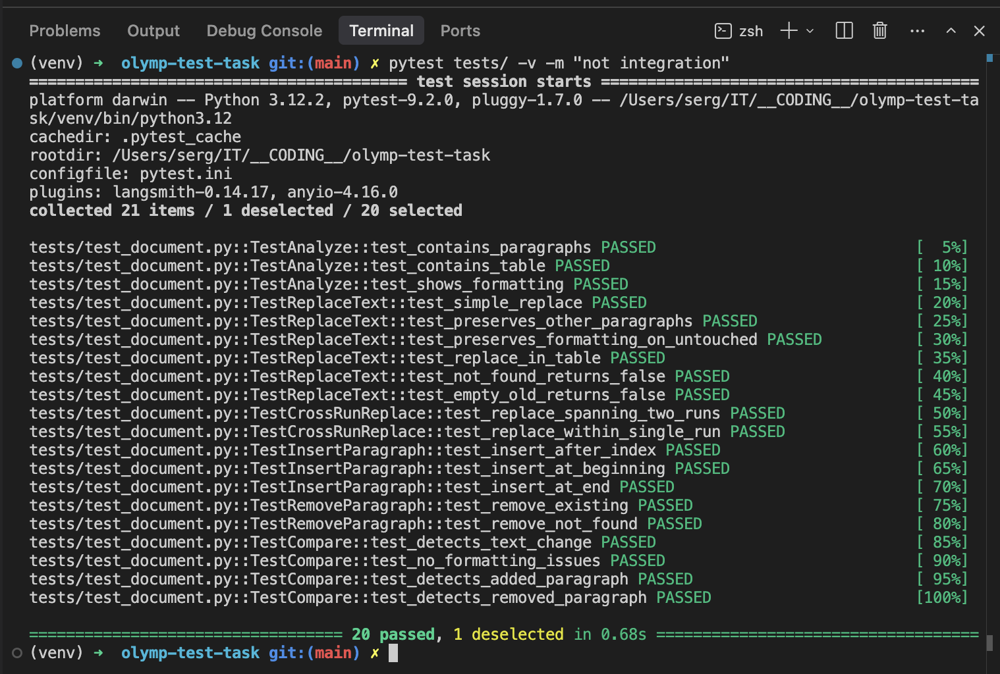
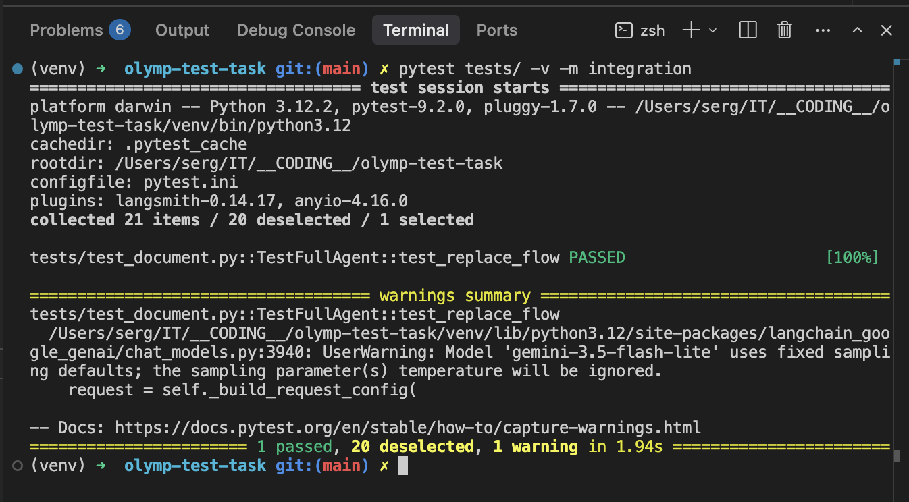
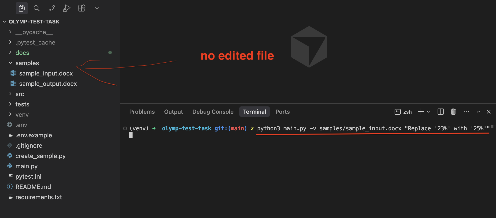
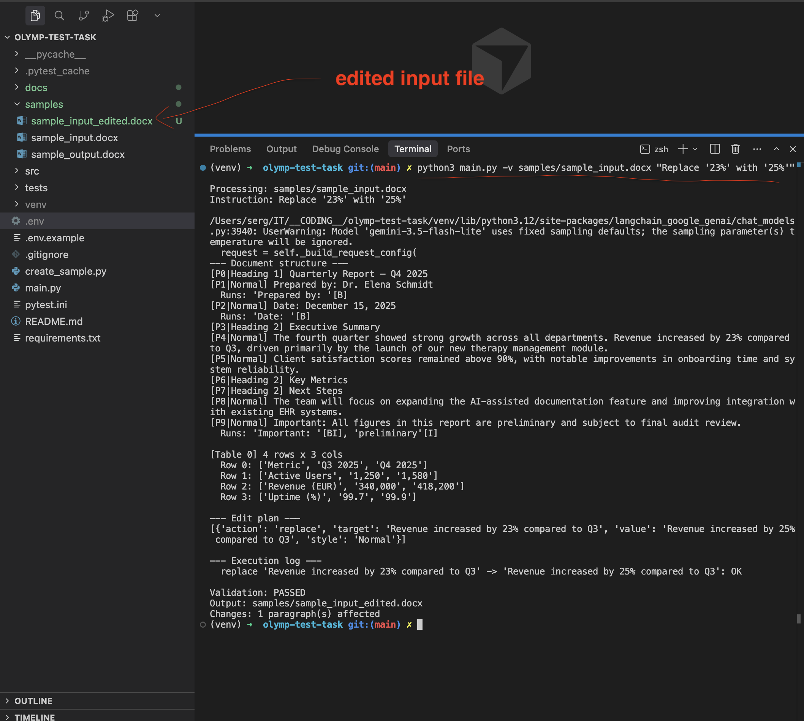
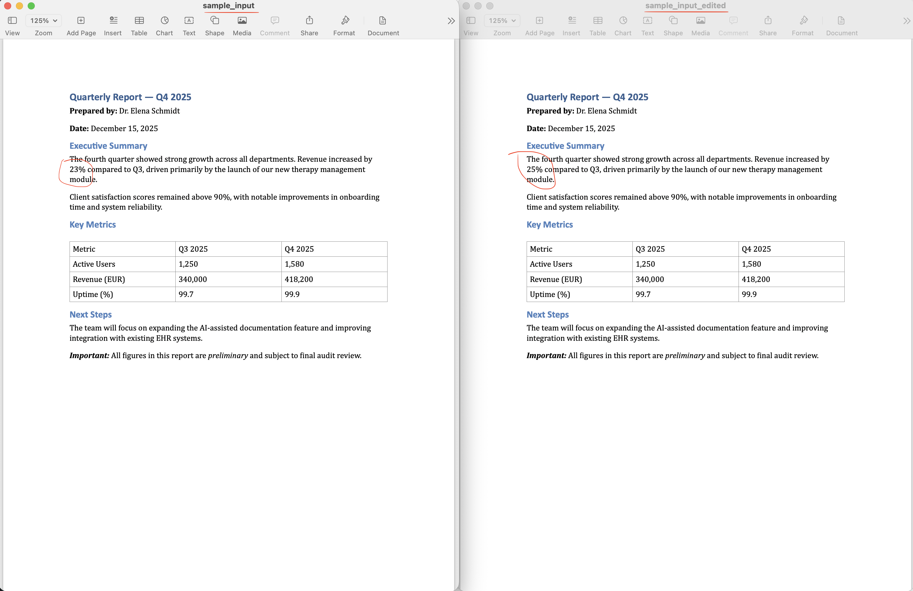
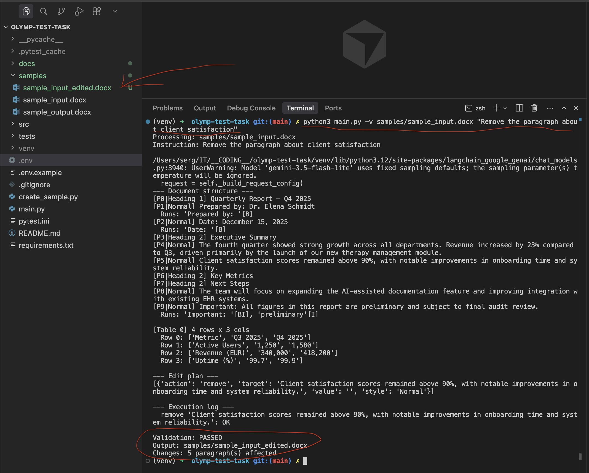
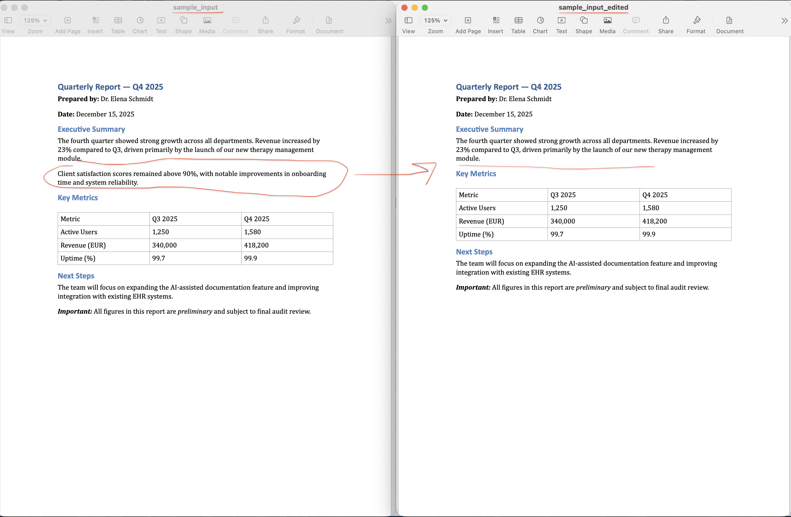
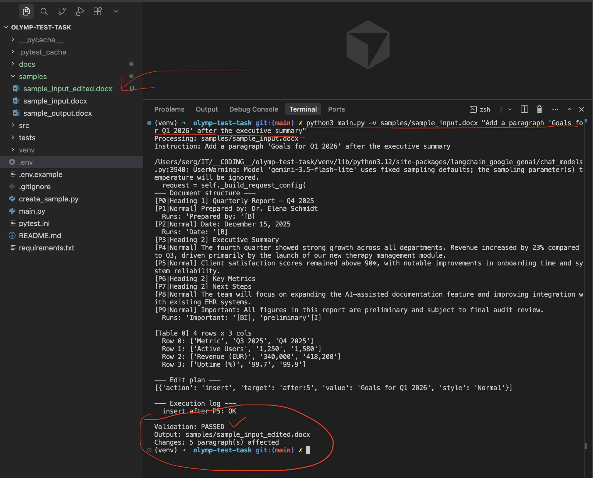
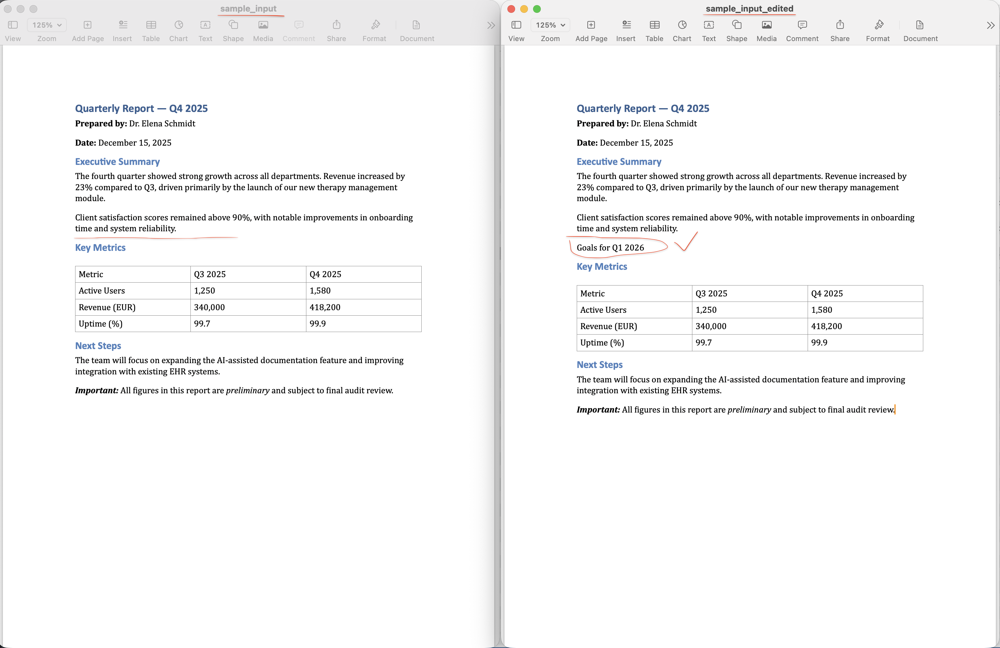

# AI-powered Word Document Editor

> Technical case study / take-home assignment for **Olymp** (Full-Stack Software Engineer).

A LangGraph-based AI agent that modifies Microsoft Word (.docx) documents in response to natural-language instructions.

## Architecture

The agent follows a **Plan → Execute → Validate** pipeline implemented as a LangGraph state graph:

1. **Analyze** — reads the `.docx` file and builds a structured text representation (paragraphs, styles, tables, formatting)
2. **Plan** — an LLM produces a minimal edit plan (structured JSON) based on the document structure and user instruction
3. **Execute** — applies each operation deterministically using `python-docx`, operating at the run level to preserve formatting
4. **Validate** — compares the original and modified documents; if operations failed or unintended formatting changes are detected, the agent retries with a corrected plan (up to 3 attempts)

## Setup

```bash
python -m venv venv
source venv/bin/activate   # Windows: venv\Scripts\activate
pip install -r requirements.txt

cp .env.example .env
# Edit .env — add your Google API key (free at aistudio.google.com)
```

## Usage

```bash
# 1. Create sample documents
python create_sample.py

# 2. Edit a document
python main.py samples/sample_input.docx "Replace '23%' with '25%'"

# Verbose output (shows structure, plan, execution log)
python main.py -v samples/sample_input.docx "Add a paragraph about Q1 goals after the executive summary"

# Custom output path
python main.py -o result.docx samples/sample_input.docx "Remove the paragraph about client satisfaction"
```

## Sample documents

| File | Description |
|------|-------------|
| `samples/sample_input.docx` | Input document with headings, bold/italic text, and a table |
| `samples/sample_output.docx` | Output after replacing "23%" → "25%" |

The sample instruction: *"Replace '23%' with '25%' in the executive summary."*

## Testing

Verification has two layers: automated unit tests for document integrity, and end-to-end runs of the full AI agent against a real `.docx` file with visual before/after checks.

### Unit tests

No API key required. Cover document analysis, replace/insert/remove, formatting preservation, and compare:

```bash
pytest tests/ -v -m "not integration"
```

**20 passed** — including preservation of untouched paragraphs, run-level bold/italic/underline, cross-run replacement, and table integrity:



What they confirm:

- **Text integrity**: non-targeted paragraphs retain identical text after editing
- **Run formatting**: bold, italic, and underline attributes are preserved on unchanged runs
- **Cross-run edits**: text spanning multiple runs is replaced correctly, keeping the first run's formatting
- **Table integrity**: table cell contents remain unchanged when only paragraph text is modified
- **Structure**: paragraph and table counts change only when the edit explicitly requires it

### Integration test

Requires `GOOGLE_API_KEY` in `.env`. Runs the full LangGraph pipeline (Analyze → Plan → Execute → Validate) against a real LLM:

```bash
pytest tests/ -v -m integration
```

**1 passed** — `TestFullAgent::test_replace_flow` replaces `23%` → `25%` end-to-end and asserts the output document:



### End-to-end agent verification

To verify that the AI agent correctly interprets natural-language instructions and that content/formatting outside the requested edit remain intact, all three core operations were run against `samples/sample_input.docx`. Each run:

1. Printed the document structure, edit plan, and execution log (`-v`)
2. Reported built-in validation as **PASSED**
3. Was checked visually in Pages: original vs `samples/sample_input_edited.docx`

**Starting state** — only the input sample exists; no edited output yet:



#### Replace

```bash
python3 main.py -v samples/sample_input.docx "Replace '23%' with '25%'"
```

The agent planned a single `replace`. Validation **PASSED**. Only the targeted percentage changed; headings, table, and surrounding formatting stayed intact.

Terminal (plan + validation):



Document (left: original `23%`, right: edited `25%`):



#### Remove

```bash
python3 main.py -v samples/sample_input.docx "Remove the paragraph about client satisfaction"
```

The agent removed the client-satisfaction paragraph. Executive Summary, Key Metrics table, and Next Steps remained unchanged.

Terminal (plan + validation):



Document (left: paragraph present, right: paragraph removed):



#### Insert

```bash
python3 main.py -v samples/sample_input.docx "Add a paragraph 'Goals for Q1 2026' after the executive summary"
```

The agent inserted the new paragraph after the Executive Summary section and before Key Metrics. Existing content and formatting were preserved.

Terminal (plan + validation):



Document (left: original, right: new paragraph circled):



## Key decisions

| Decision | Rationale |
|----------|-----------|
| Structured edit plan (not free-form code) | Predictable, auditable operations; no shell/code execution needed |
| Run-level replacement | Preserves bold/italic/underline — the smallest formatting unit in `.docx` |
| Deterministic validation | No LLM needed for verification; reliable, reproducible checks |
| Retry loop with error context | Failed edits feed back into re-planning, improving reliability |

## Known limitations

- Hyperlink text inside paragraphs is outside the run-based replacement scope
- Merged or deeply nested table cells may not be fully handled
- Inserted paragraphs use the specified style but do not inherit complex formatting from neighbors
- The agent requires target text to exist verbatim for replacement (character-perfect match)
